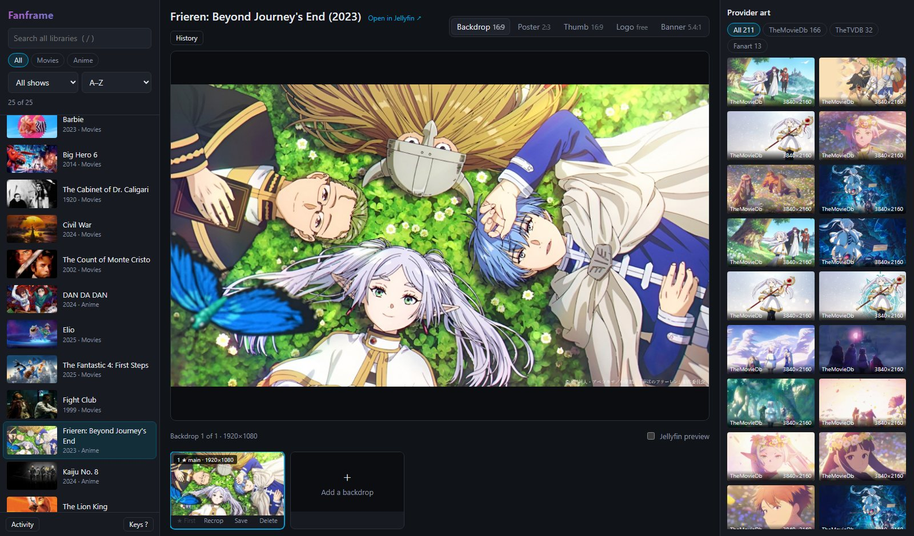
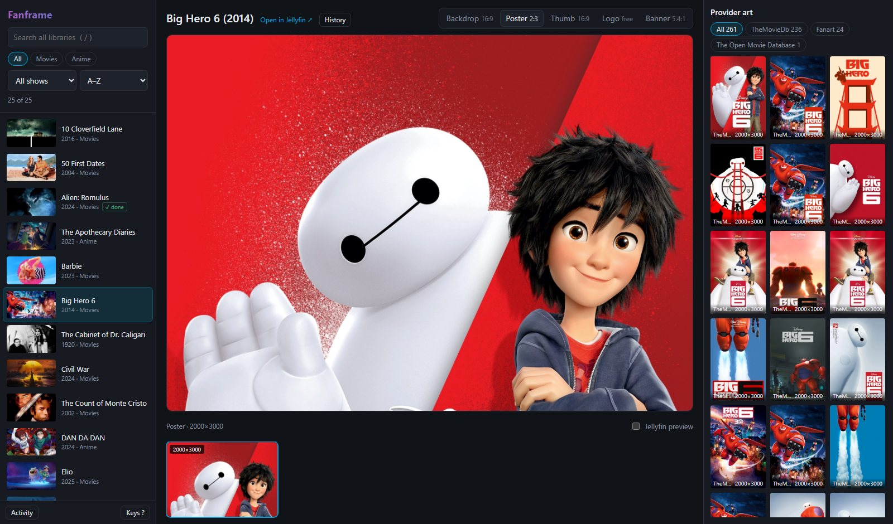

# Fanframe

**An artwork editor for Jellyfin.** Hand-pick the artwork for your Jellyfin shows and movies. Pick an item, drop in an image (or choose
one of the images TVDB, TMDB and Fanart offer), crop it, save it. Made for items whose provider art is
missing or dull, which happens a lot with less popular series.



- Backdrops, posters, thumbs, logos and banners, each cropped to the shape Jellyfin uses.
- Replace, add, delete or reorder single backdrops ("make this the main one").
- Drag images straight from a browser tab, paste them, or pick provider art from a side panel.
- A **Jellyfin preview** shows where Jellyfin's fade, logo and title will sit over a backdrop.
- Every change is backed up: **Undo** right after, or **History** to restore any earlier version.
- Keyboard driven if you like (`?` lists the keys).

Small and self-contained: Python 3 standard library on the server, plain HTML/JS in the browser.
The Jellyfin API key stays on the server.

## Run it

### Docker

```bash
docker run -d --name fanframe \
  -p 8765:8765 \
  -e JELLYFIN_URL=http://192.168.1.10:8096 \
  -e JELLYFIN_API_KEY=your-key \
  -e FANFRAME_PASSWORD=choose-one \
  -v /path/to/appdata/fanframe:/config \
  ghcr.io/angelmarquez/fanframe:latest
```

Then open `http://<host>:8765`. Images are built for amd64 and arm64; `:latest` follows the main
branch, release tags (`:1.0.0`, `:1.0`) stay put. To build it yourself: `docker build -t fanframe .`
The server gives `/config` to `PUID`:`PGID` (default `99:100`, Unraid's `nobody:users`) and runs as that
user; set `-e PUID=1000 -e PGID=1000` (or whatever owns your appdata) to change it.

Behind a reverse proxy it works at the root of a host name or under a sub-path (`/fanframe/`, with
the trailing slash).

### From source

```bash
python server.py
```

It opens `http://127.0.0.1:8765` in your browser. Settings go in `config.json` next to `server.py`
(copy `config.example.json`) or in environment variables. On Windows, `start.cmd` does the same.
Starting it again while it runs just opens the page.

## Settings

Environment variables win over `config.json` (same names in lower case without the prefix:
`url`, `api_key`, `public_url`, `password`, `media_readonly`).

| Variable | Needed | What it does |
|---|---|---|
| `JELLYFIN_URL` | yes | How the **server** reaches Jellyfin, e.g. `http://192.168.1.10:8096`. In Docker, the host's address (not `localhost`). |
| `JELLYFIN_API_KEY` | yes | Jellyfin → Dashboard → API Keys → **+**. Give it its own name so you can revoke it later. |
| `JELLYFIN_PUBLIC_URL` | no | The address your **browser** uses for Jellyfin, for the "Open in Jellyfin" link. Defaults to `JELLYFIN_URL`. |
| `FANFRAME_PASSWORD` | no, but recommended | Asks for this password (any user name) before showing anything. Without it, anyone who can reach the port can change your artwork. |
| `MEDIA_READONLY` | no (default `true`) | Images stored **inside a library folder** (next to the media files, e.g. `folder.jpg`) are shown with a 🔒 and left alone. Set `false` if Jellyfin can write to your media folders. |
| `FANFRAME_DATA` | no | Folder for `config.json`, `backups/` and `custom.json`. `/config` in Docker, the code folder otherwise. |
| `FANFRAME_HOST`, `FANFRAME_PORT` | no | Listen address and port. Defaults `127.0.0.1` / `8765` from source, `0.0.0.0` / `8765` in Docker. |
| `PUID`, `PGID` | no (Docker) | User and group that own `/config` and run the server. Default `99` / `100`. |

**About `MEDIA_READONLY`:** many setups mount media read-only into Jellyfin. Jellyfin then still
*shows* art saved next to the media but can't delete or move it, and a reorder can fail halfway and
lose the new image. With the default, the app refuses to touch those images instead. Art you save
with the app goes into Jellyfin's own metadata folder, so it works either way.

**Security:** the app can change artwork for every item, so keep it on your own network (or behind a
VPN such as Tailscale) and set `FANFRAME_PASSWORD`. The app speaks plain HTTP, so the password is only
protected on a network you trust: to reach it from outside, put it behind an HTTPS reverse proxy or a VPN. Changes only come from the app's own page (a custom
header that other web pages can't send), and images dragged in from the web are only downloaded from
public internet addresses, never from your local network. Images over 50 MB are refused.

## Use

The model is **pick an item → pick a slot → bring art in → Save**.

1. **Pick an item** on the left (↑ ↓). Search covers every library; the chips narrow it to one.
   Badges: **✓ done** (changed here), **⚠ 900px** (low-res first backdrop), **∅ none** (no backdrop).
2. **Pick the type** (1–5): Backdrop, Poster, Thumb, Logo, Banner. Hover a type to see where Jellyfin shows it.
3. **Pick a slot** in the filmstrip (← →). The stage shows it full size. **+ Add** is an empty slot.
   Each slot has **★ First** (make it the main backdrop, F), **Recrop**, **Save** (to your computer) and **Delete** (Del).
4. **Bring art in:** drop a file or an image from a browser tab anywhere on the page, paste (Ctrl+V),
   **Choose file…**, or click a tile in **Provider art**. It becomes a **draft** for the selected slot.
5. Crop. **Jellyfin preview** (P) shows Jellyfin's fade, logo and title over a backdrop. Hold **Space**
   to compare with the current image.
6. **Save** (Enter) replaces only that slot, or adds a new image from **+ Add**. **Cancel** (Esc) drops the draft.

Drafts belong to one item: switching items asks before throwing away a crop. Every change shows an
**Undo** button for 15 s, and **History** lists every earlier version (thumbnails, Restore). Backups live
in `backups/<Name> [<id>]/<time>-<Type>-<action>/` in the data folder. **Activity** keeps the last 50
messages; errors stay on screen until closed.

Good places to find art: wallpaper sites (for 16:9 backdrops) and fan-art galleries; posters are
often easier to find than backdrops.

**Keep your changes:** a normal library scan leaves uploaded art alone. A manual **Refresh metadata**
with **Replace existing images** ticked replaces it with provider art again.



## How it works

| Piece | What it does |
|---|---|
| `server.py` | Serves the page, proxies Jellyfin calls and thumbnails, downloads dragged-in web images (the browser can't, because of CORS), backs up, deletes, uploads, reorders, restores. |
| `static/app.js` | Item list, slots, drafts, cropping, provider art, history, keyboard. |
| `static/vendor/` | Cropper.js 1.6.2 (MIT), bundled. |

Jellyfin API calls used: `GET /Items/{id}/Images` (list), `POST /Items/{id}/Images/{type}` (upload;
body is the base64 image, `Content-Type` the image type), `DELETE /Items/{id}/Images/{type}/{index}`,
`POST /Items/{id}/Images/Backdrop/{i}/Index?newIndex=j` (swaps two backdrops: replace-one is upload,
swap into place, delete the old one; make-first is a chain of adjacent swaps),
`GET /Items/{id}/RemoteImages` (provider art), `GET /Library/VirtualFolders` (libraries and their
folders). Auth header: `Authorization: MediaBrowser Token="<key>"`.

Tested with Jellyfin 12.2.

## License

MIT, see [LICENSE](LICENSE). Bundles [Cropper.js](https://github.com/fengyuanchen/cropperjs) (MIT).
Not affiliated with the Jellyfin project.

## AI Disclosure

Anthropic and OpenAI models were used in the creation and development of this repository.
